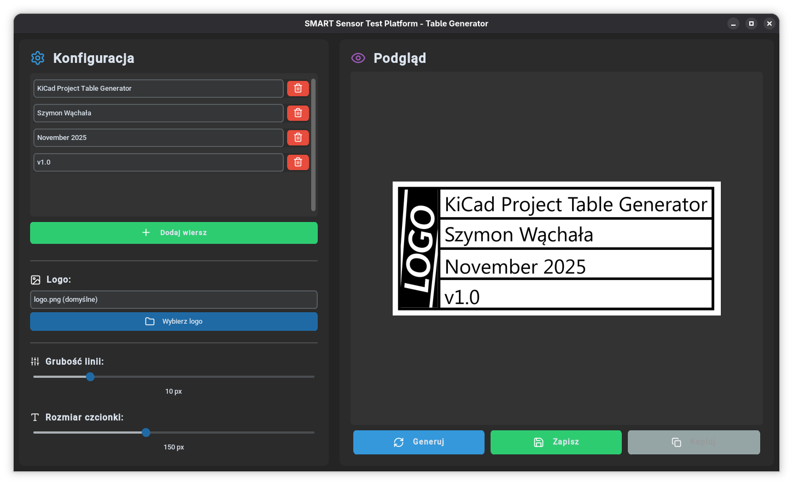
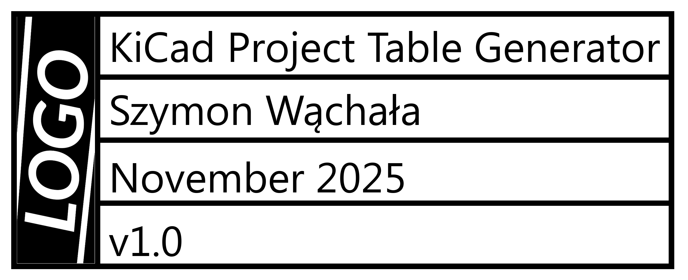
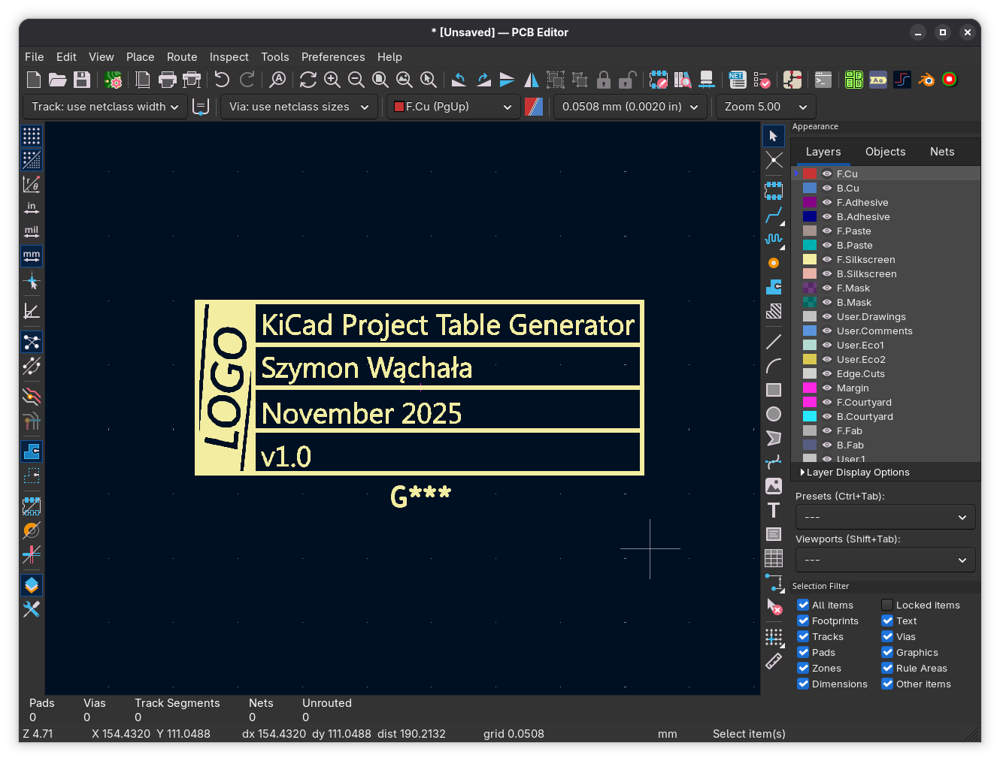
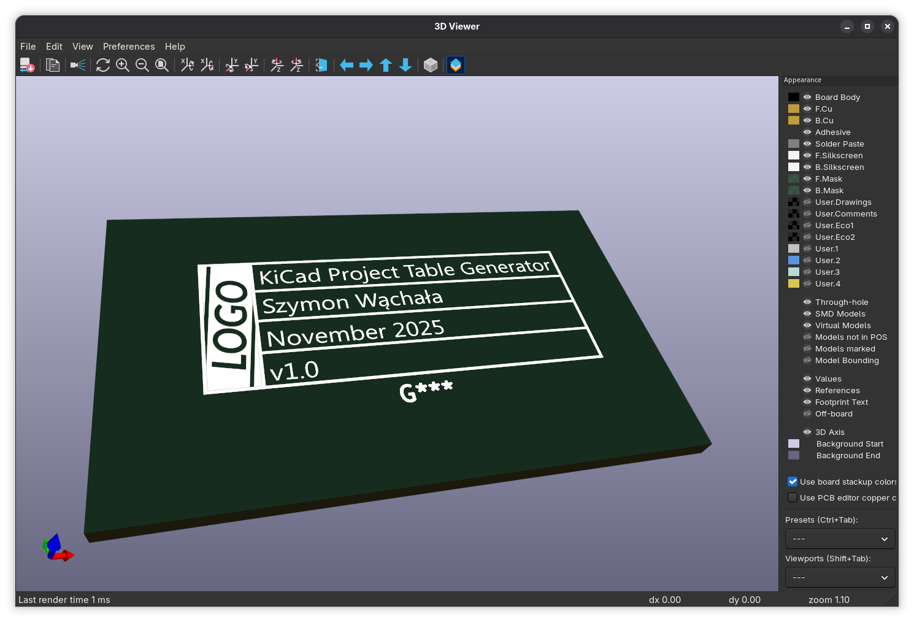

<div align="center">
  
# 🖼️ KiCad Project Table Generator

</div>
An application for generating professional descriptive tables for PCB projects. Creates images with logos and labels that can be placed on printed circuit boards for better appearance and functionality.



## ✨ Features

- 📊 **Dynamic table creation** - Add any number of rows with descriptions
- 🎨 **Configurable parameters** - Adjust font size and line thickness to your needs
- 🖼️ **Logo integration** - Automatic scaling and positioning of company/project logo
- 👁️ **Live preview** - See the result before saving
- 💾 **Export to PNG/JPEG** - Save in popular graphic formats


## 🚀 Quick Start

### Requirements

- Python 3.8 or newer
- Operating System: Windows / Linux / macOS

### Installation

```bash
# Install dependencies
pip install -r requirements.txt

# Make the script executable (Linux/macOS)
chmod +x ./run.sh

# Run the application
./run.sh
```

## 🎯 Usage Instructions

### 1. Adding rows with descriptions

- Click the **"Add Row"** button to add a new row to the table
- Enter text in the field (e.g., "Project Name", "Production Date", "Author", etc.)
- Use the 🗑️ button to remove unnecessary rows
- You can add any number of rows

### 2. Selecting a logo

- Click **"Select Logo"**
- Choose a PNG/JPG file with your company or project logo
- The logo will be automatically scaled to match the table height
- If you have a file at `assets/images/logo.png`, it will be loaded automatically

### 3. Adjusting parameters

**Line Thickness (5-30 px)**
- Controls the thickness of the table border
- Recommended: 10-15 px for standard PCBs

**Font Size (50-300 px)**
- Adjust to the size of your board
- Recommended: 100-150 px for small PCBs, 200-300 px for larger ones

### 4. Generating and saving

1. Click **"Generate"** to see the preview
2. Check if everything looks good
3. Click **"Save"** and choose a location
4. Select format: PNG (recommended) or JPEG

## 🛠️ Project Development

### Planned features

- [ ] Direct export to KiCad footprint
- [ ] Templates
- [ ] Export to SVG
- [ ] Text instead of logo

## 📸 Gallery

### Example of generated table


### Usage in KiCad


### Usage on PCB


---
