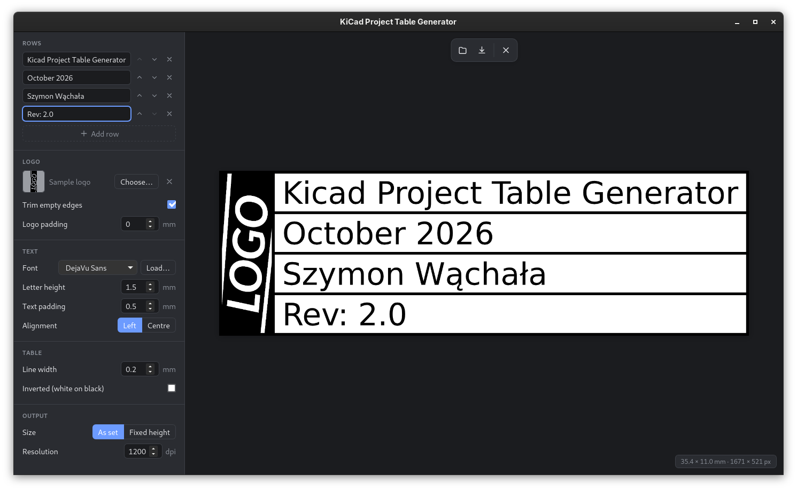
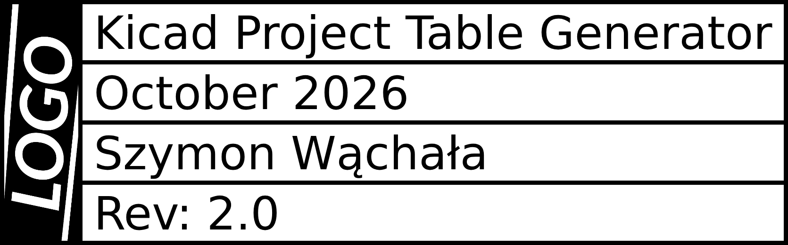
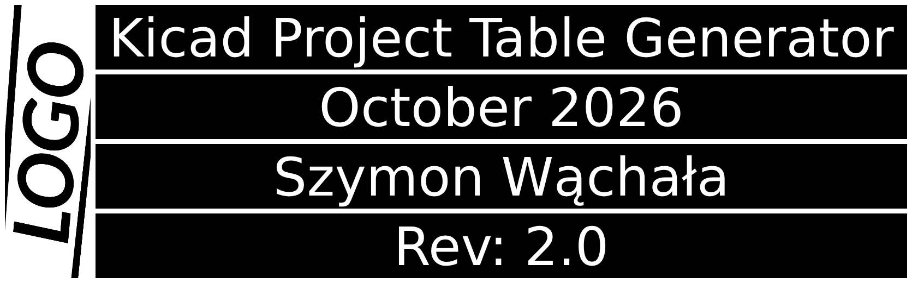
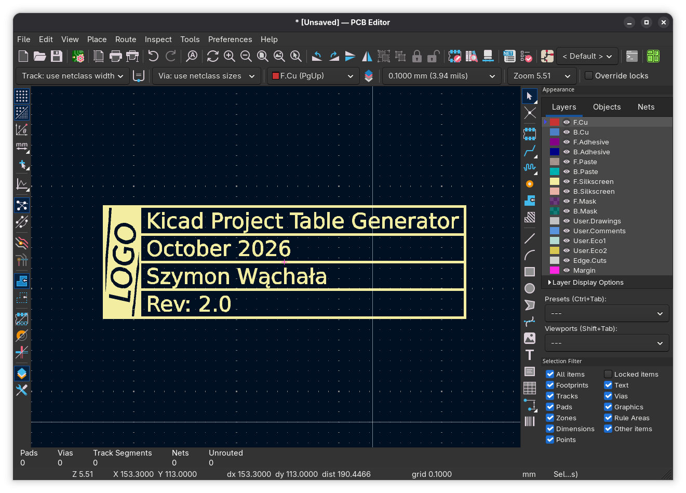
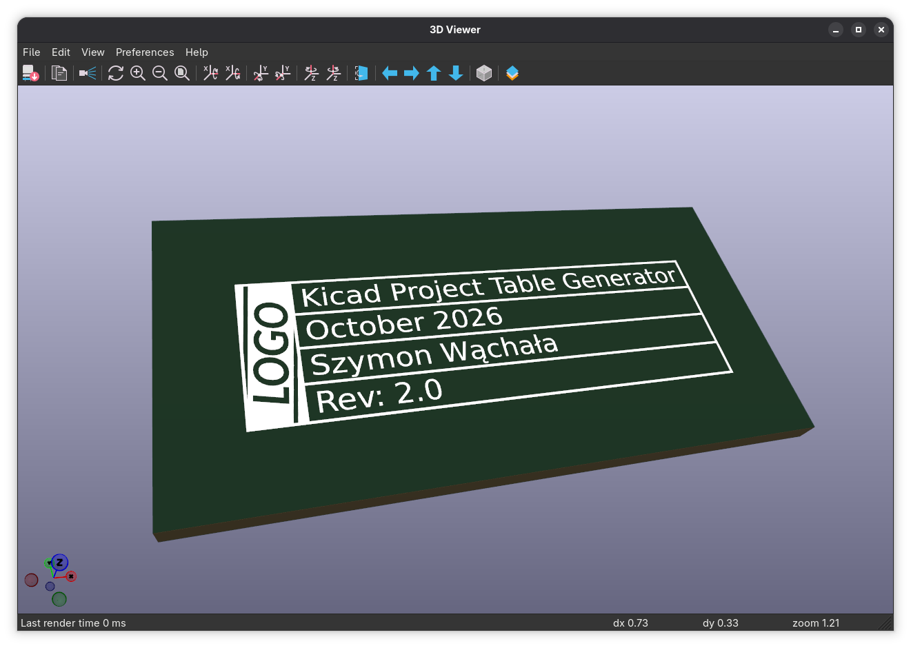

<div align="center">

# KiCad Project Table Generator

[](#how-this-was-made)
[](https://claude.com/claude-code)


[](LICENSE)

</div>

Makes the small table you put on a PCB to say what the board is: a logo next to a few rows of text, such as the project name, the author, the date and the revision. You set the sizes in millimetres, copy the table, and paste it into the KiCad PCB editor as a footprint. It can also be exported as a PNG or SVG.

**[Open it in your browser](https://szymon423.github.io/KiCad-Project-Table-Generator/app/)** · [Website](https://szymon423.github.io/KiCad-Project-Table-Generator/)

Nothing is installed, and your logo and text stay on your computer. The same app can also be built as a desktop program.

<p align="center">
  
</p>

## What you get

<p align="center">
  
  
</p>
<p align="center">
  <sub>Two exports of the same rows, normal and inverted. The editable project is in <a href="example/example.ktable"><code>example/example.ktable</code></a>, and the SVG in <a href="example/table.svg"><code>example/table.svg</code></a>.</sub>
</p>

## What it can do

- **Straight into KiCad**: copy the table as a footprint and paste it into the PCB editor, at the right size, with no Image Converter step. It can also be saved as a `.kicad_mod` file.
- **Live preview**: the table redraws as you type.
- **Sizes in millimetres**: letter height, line width and padding are set in mm, and the size of the finished table is shown in the corner.
- **Fixed height**: instead of adding the lengths up, set how tall the whole table must be and everything is scaled to fit. The width follows from the text.
- **No outer margin**: the table's outer lines are the edges of the image, so the width and height you give it in KiCad are the size of the table itself.
- **Logo**: choose, drop or paste a PNG, JPG or SVG, or type a word and pick its font instead. Turn it in 90° steps or invert its colours on their own. Transparent or white edges of the logo file are trimmed, so one padding value sets the space around it.
- **Rows**: add, remove and reorder as many as you need.
- **Fonts**: DejaVu Sans and Liberation Sans are built in, and you can load your own TTF, OTF or WOFF file.
- **Export**: PNG at the resolution you choose (the DPI is written into the file), SVG, or straight to the clipboard. Black on white, or inverted.
- **Editable projects**: save the table as a `.ktable` file with the logo and font inside it, and open it later to bump the revision and export again.
- **Remembers your work**: the rows, logo and settings are still there the next time you open the app.

## Using the table in KiCad

1. Choose **Copy as KiCad footprint** in the output menu, or press `Ctrl+K`.
2. Switch to the KiCad PCB editor and paste with `Ctrl+V`.
3. Place the table. It arrives on the front silkscreen at the size shown in the app; press `F` in KiCad to flip it to the back, which also mirrors it.

**Export as KiCad footprint** saves the same thing as a `.kicad_mod` file for a footprint library.

<p align="center">
  
  
</p>

The footprint is traced from the finished picture, so it holds exactly what the preview shows, logo and inverted look included. Its outlines follow the picture to within about 0.01 mm.

The older route still works: export a PNG, open it in KiCad's **Image Converter** and set the output size to the millimetres shown in the app.

## Keyboard shortcuts

| Key | Action |
| --- | --- |
| `Enter` | Add a row below the current one |
| `Backspace` in an empty row | Remove that row |
| `Alt+Up` / `Alt+Down` | Move the current row up or down |
| `Ctrl+V` | Paste an image as the logo |
| `Ctrl+K` | Copy the table as a KiCad footprint |
| `Ctrl+C` | Copy the table to the clipboard as an image |
| `Ctrl+E` | Export as PNG |
| `Ctrl+S` | Save the editable project |
| `Ctrl+O` | Open a saved project |

Copying, every export format and saving are also in the output menu (the download icon above the preview). A project, a logo or a font can be dropped onto the window as well.

## How this was made

This app is vibe-coded, and this page does not hide it. The code was written by an AI assistant ([Claude Code](https://claude.com/claude-code)) and directed by a human: Szymon decided what the app should do, tried it, and sent back what to change.

What that means if you use it:

- It is a personal tool that works for its author, not a reviewed or audited product.
- There are no automated tests. Output was checked by rendering sample tables in a headless browser, comparing the PNG and SVG results, and rendering the footprints with `kicad-cli`.
- The desktop app has only been built on Linux (Fedora). Windows and macOS should work, since Tauri supports them, but nobody has tried.
- It replaces an earlier Python version of the same tool, which is still in the git history.

Bug reports are welcome.

## Running it yourself

You need [Node.js](https://nodejs.org) with npm.

```sh
npm install
npm run dev        # the app at http://localhost:1420, with hot reload
npm run build      # type-check and production build into dist/
npm run build:web  # the website into dist-web/: landing page at the root, the app under app/
```

Every push to `main` publishes the website to GitHub Pages through `.github/workflows/pages.yml`: the landing page from `site/` at the root and the app under `app/`.

### Desktop app

The desktop app is the same code in a [Tauri 2](https://tauri.app) window. On top of Node.js it needs [Rust](https://rustup.rs) and the Tauri system packages for your platform; see the [Tauri prerequisites](https://tauri.app/start/prerequisites/).

```sh
npm run tauri dev     # run the desktop app with hot reload
npm run tauri build   # build the program and its installers
```

The program ends up in `src-tauri/target/release/` and the packages in `src-tauri/target/release/bundle/`. On Fedora, install the RPM:

```sh
sudo dnf install "src-tauri/target/release/bundle/rpm/KiCad Project Table Generator-0.1.0-1.x86_64.rpm"
```

It then appears in the application menu and starts with `kicad-project-table-generator` from a terminal. In the desktop app, saving and opening go through the system's file dialogs.

## Project layout

```
index.html       Panel and toolbar markup
src/model.ts     The document: rows, logo and settings, in millimetres
src/layout.ts    Turns the document into exact pixel geometry
src/render.ts    Draws that geometry on a canvas
src/export.ts    PNG with DPI, SVG, clipboard, file name
src/footprint.ts KiCad footprint: traces the rendered table into polygons
src/project.ts   Editable .ktable project files
src/logo.ts      Decodes a logo and finds its empty edges
src/fonts.ts     Built-in fonts, font parsing, text width and letter outlines
src/files.ts     Save and open dialogs and the clipboard, for desktop and browser
src/storage.ts   Remembers the last session
src/rows.ts      The editable list of rows
src/main.ts      Wires the form, preview and output together
src-tauri/       Desktop shell: window, plugins, bundling config, icons
public/          Built-in fonts with their licenses, sample logo, icon
site/            Landing page of the website
scripts/         Build helper that assembles the website
example/         Screenshots and sample output used on this page and on the website
.github/         Workflow that publishes the website
```

## Notes

- Text is laid out left to right with kerning. Ligatures and right-to-left scripts are not supported.
- A `.ktable` file is JSON with the logo and any loaded font embedded in it.
- In the SVG the logo is an embedded picture, and an inverted SVG is a black rectangle with white shapes on top. For KiCad, use the footprint instead of importing the SVG.

## Planned

- Installers for Windows and macOS
- SVG logos kept as vector outlines in the SVG export

## License

Released under the [MIT License](LICENSE). The bundled fonts in `public/fonts/` come under their own free licenses, included next to them: DejaVu Sans under the [Bitstream Vera and DejaVu license](public/fonts/DejaVu-LICENSE.txt), Liberation Sans under the [SIL Open Font License](public/fonts/Liberation-LICENSE.txt).
